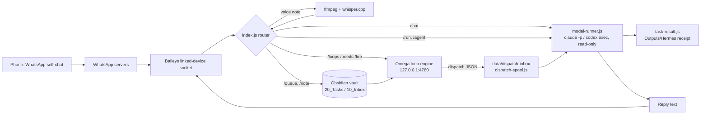

# Hermes WhatsApp Agent

A WhatsApp gateway that runs on your Mac, links to your account as a Linked Device, and answers your messages with the Claude Code (or Codex) CLI you are already logged into, in read-only mode.

Hermes is the phone side of [Omega](https://github.com/ianroyes-sys/omega-agent-os), a local personal agent system. You text it from the "Message yourself" chat; it reads your Obsidian vault for context, runs tasks now or queues them for Omega's overnight run, and texts the result back.

## Why

Agent tooling on a laptop is only useful while you are at the laptop. Hermes puts a narrow, read-only line to that machine in a chat app you already have open, without adding a hosted backend, a bot number, or a separate API key. The model calls go through the local CLI and its existing login.

## Features

- **Self-chat assistant.** Replies only in your own "Message yourself" chat by default, prefixed with a marker so it never answers itself. Other senders must be allow-listed.
- **Read-only model calls.** Claude Code runs with `Read,Glob,Grep,WebSearch,WebFetch` only, `--permission-mode dontAsk`, no MCP servers, no user settings or hooks, and no persisted session. Codex runs in its `read-only` sandbox. There is no automatic retry with more permissions.
- **Vault-aware context.** Each chat gets a cached snapshot of the vault: inbox count, task lanes, recent notes, latest morning brief.
- **Task dispatch from the phone.**
  - `/run <task>` executes now and texts the answer back.
  - `/school`, `/creative`, `/business`, `/research`, `/verify`, `/devil`, `/scribe <task>` apply a specific role defined in the vault's `.claude/agents/`.
  - `/queue <task>` writes a task file to `20_Tasks/Midnight` for Omega's 1am run.
  - `/note <thought>` captures to `10_Inbox`.
  - `/status`, `/brief`, `/agents`, `/new`, `/help`.
- **Result receipts.** Every `/run` writes `Outputs/Hermes/<id>/result.md` plus `receipt.json`. The receipt keeps process outcome, the model's reported status, and verification separate, and checks any claimed evidence files by SHA-256 inside an allow-listed set of folders. A returned answer is labelled "Result ready", never "verified".
- **Omega loop bridge.** `/loops`, `/needs`, `/answer <loop> <text>` and `/fire <slug>` talk to Omega's loop engine over its local API, so the engine's own gates still apply.
- **Dispatch spool.** Omega can drop `{task, agent}` or `{notify}` JSON files into `data/dispatch-inbox/`. Hermes claims each one with a hard link, runs it, and queues the result for delivery. A claimed job that crashes or has an uncertain send stays as `*.json.processing` for manual reconciliation instead of being replayed.
- **Voice notes.** Transcribed on-device with ffmpeg and whisper.cpp, then routed by their first word ("run …", "queue …", "note …", or an agent name), otherwise treated as chat.
- **Connection state.** `data/activity.json` reports `connected` and `pairingRequired` separately from the process heartbeat, so a dashboard can tell "running" from "linked".

## How it works



- `index.js` holds the WhatsApp connection (via `@whiskeysockets/baileys`), command routing, the vault writers, the Omega bridge and the dispatch poller.
- `model-runner.js` spawns the CLI with the prompt on stdin, kills the whole process group on timeout, and never replays an interrupted run.
- `vault-context.js` builds the cached vault snapshot that goes into each prompt.
- `task-result.js` parses structured results and writes the paired result/receipt atomically.
- `dispatch-spool.js` implements claim, acknowledge and result-queue for the file spool.

Conversation memory is the last 20 turns per chat in `data/sessions.json`, with an append-only history in `data/conversations/`. Both stay local and are gitignored.

## Tech stack

- Node.js (CommonJS), no build step
- [Baileys](https://github.com/WhiskeySockets/Baileys) for the WhatsApp Web protocol, `qrcode-terminal`, `pino`
- Claude Code CLI or Codex CLI as the model backend
- ffmpeg + whisper.cpp for voice notes
- macOS LaunchAgent for running in the background
- `node:test` for tests

## Getting started

Requirements: macOS, Node 20+, and either the Claude Code CLI (logged in) or the Codex CLI.

```bash
git clone https://github.com/ianroyes-sys/hermes-whatsapp-agent.git
cd hermes-whatsapp-agent
npm install
cp config.example.json config.json   # optional; the example is used if config.json is missing
npm start
```

On first start a QR code appears in the terminal. On your phone: **WhatsApp → Settings → Linked Devices → Link a Device**, then scan it. Open your own chat ("Message yourself") and send `/help`.

Configuration:

- `config.json` sets the bot name, owner name, reply prefix, chat and dispatch model tiers (`haiku`, `sonnet`, `opus`, or a `claude-*` id), timeouts and `allowFrom`.
- Environment variables are listed in [`.env.example`](.env.example). The ones you are most likely to set are `VAULT_PATH` (your Obsidian vault), `OMEGA_DIR`, `HERMES_MODEL_BACKEND` and `HERMES_ALLOW_FROM`.
- Voice notes need `bin/ffmpeg`, `whisper.cpp/build/bin/whisper-cli` and `whisper.cpp/models/ggml-base.en.bin` under `HERMES_TOOLS_DIR`, or explicit `ffmpegPath`, `whisperPath` and `whisperModel` keys in `config.json`. Without them Hermes replies that transcription isn't set up.

Run in the background:

```bash
cp launchd/hermes.plist.example ~/Library/LaunchAgents/com.example.hermes-whatsapp-agent.plist
# edit the REPLACE_ME paths, then:
launchctl bootstrap gui/$(id -u) ~/Library/LaunchAgents/com.example.hermes-whatsapp-agent.plist
```

`npm run link` stops the LaunchAgent, shows a fresh QR, and restarts it after pairing. The Mac has to be on and awake for replies; `caffeinate -s` keeps it awake while plugged in.

Other scripts:

- `npm test` runs the receipt, spool and model-runner tests. They do not log into WhatsApp or call a model.
- `npm run reset` clears chat memory (`data/sessions.json`).
- `npm run logout` deletes the linked-device credentials in `auth/` and chat memory.

Without an Omega install, chat, `/run`, `/note`, `/queue` and voice notes still work against any folder you point `VAULT_PATH` at; the loop commands report that Omega is unreachable.

## Security notes

- `auth/` is the linked-device session. Anyone with it can read and send as your WhatsApp account. It is gitignored; if it leaks, unlink the device in WhatsApp right away.
- `data/` holds message text and conversation history. It is gitignored.
- Baileys speaks the WhatsApp Web protocol but is not an official Meta API, and WhatsApp's terms do not permit automation. Keep this to personal use on your own account and never use it for bulk messaging.

## Project structure

```
index.js               WhatsApp connection, command router, vault writers, Omega bridge, dispatch poller
model-runner.js        Read-only Claude Code / Codex process runner
vault-context.js       Cached vault snapshot injected into prompts
task-result.js         Structured result parsing and result/receipt persistence
dispatch-spool.js      File spool claim / ack / result queue
*.test.js              node:test suites for the modules above
config.example.json    Default configuration
launchd/               LaunchAgent template
link.sh                Re-pair helper that restarts the LaunchAgent
.env.example           Optional environment variables
```

## Status

Personal tool that runs on the author's Mac as part of the Omega setup. It is not packaged for general distribution: the vault layout (`10_Inbox`, `20_Tasks/*`, `Cadence/Briefs`, `Outputs/Hermes`) and the agent roster follow the author's own Obsidian vault and need editing to match yours.

Built by [Ian Royes](https://github.com/ianroyes-sys)
